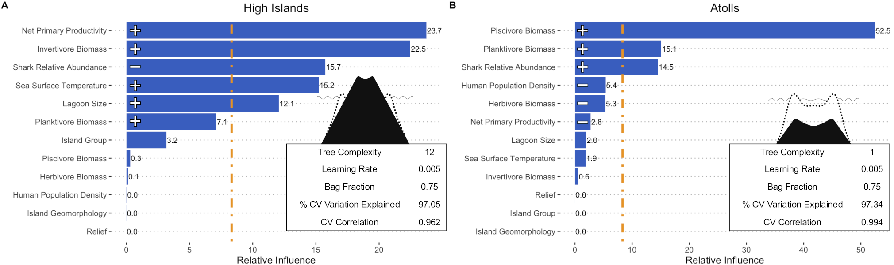
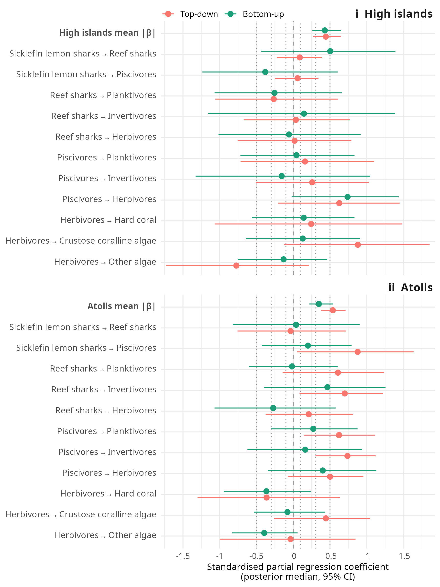
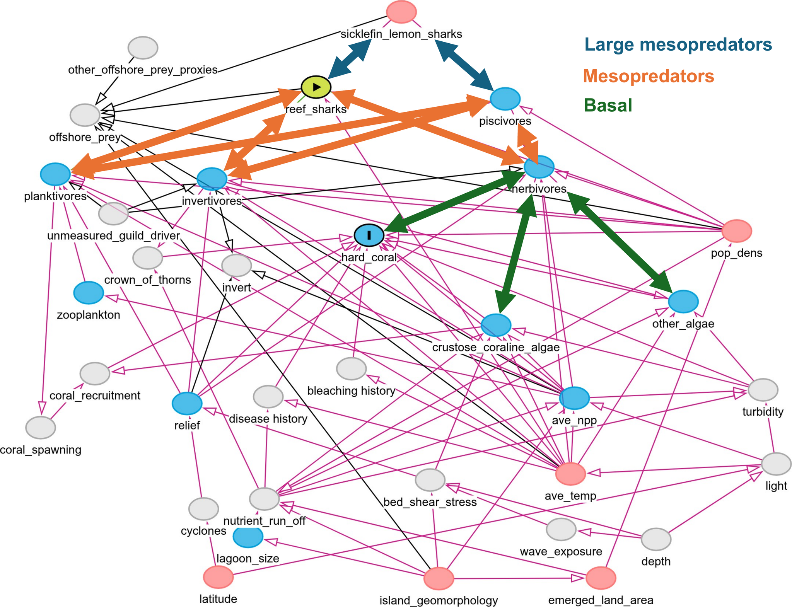
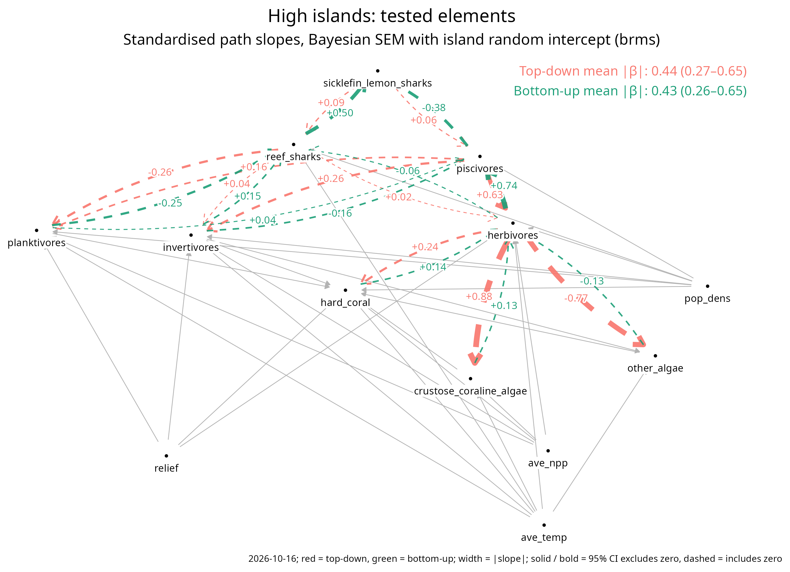
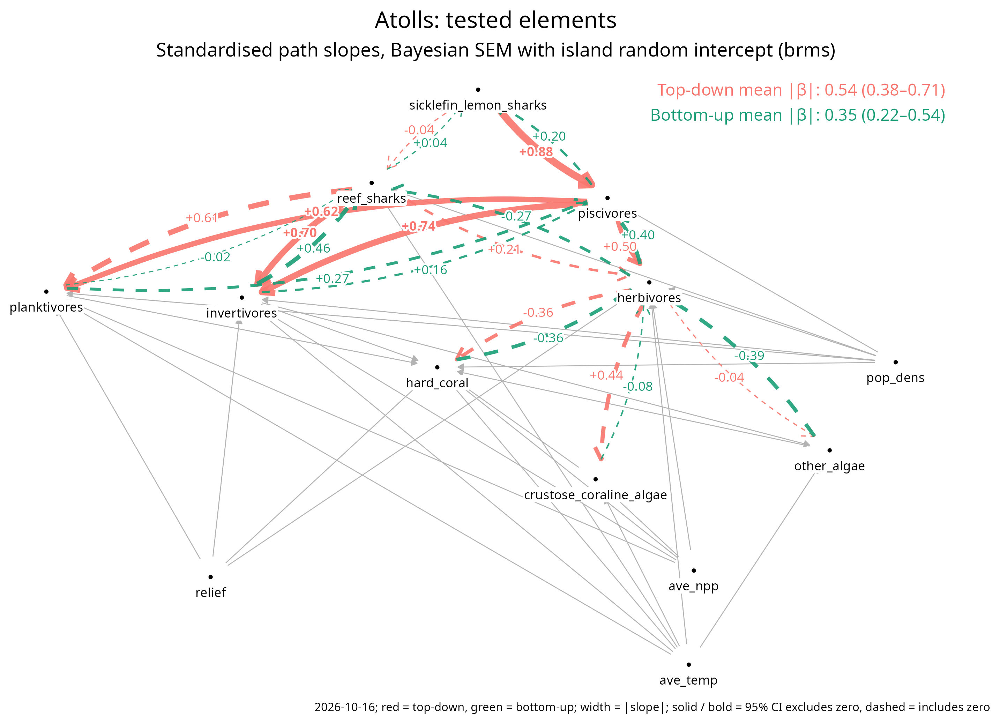
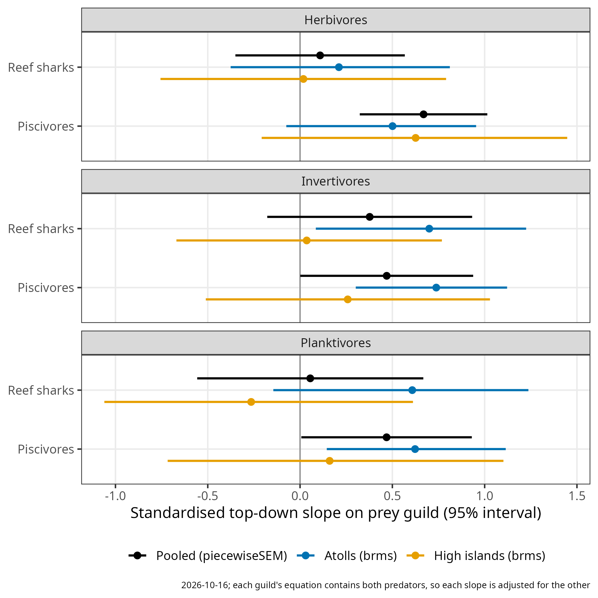
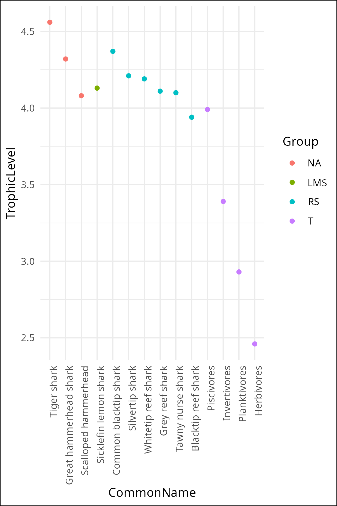

# Top-down and bottom-up forcing on French Polynesian coral reefs

[](LICENSE)
[](https://doi.org/10.34703/gzx1-9v95/1L510G)
[](https://doi.org/10.5281/zenodo.19835080)

Analysis code for the manuscript:

> **Dedman, S., Farabaugh, N. F., Bond, M. E., Chapman, D., Clua, E., Harborne, A. R., Papastamatiou, Y. P., Kiszka, J. J., Heupel, M., Wirsing, A. J., & Heithaus, M. R. (2026). Top-down and bottom-up forcing on coral reefs changes with habitat-specific predator abundance.** *Science*, in revision. DOI: TBD.

Corresponding author: Simon Dedman (simondedman@gmail.com). Co-first authors: Simon Dedman and Naomi F. Farabaugh.

> **Status (November 2026).** The manuscript is in revision after the first round of review. The analytical approach changed in response to review (see "What changed in the revision"), and the figures below are the current drafts. The Zenodo DOI above archives v1.0.0, the code as first submitted; a new release will follow acceptance.

---

## Overview

We test whether top-down forcing (sharks → mesopredators → teleost prey guilds → benthos) or bottom-up forcing (the same links reversed) better explains coral-reef community structure across 24 reefs on 12 islands in French Polynesia, and whether the balance differs between atolls (where sharks are abundant) and high islands (where sharks are sparse).

Surveys combine baited remote underwater video (BRUV) for sharks, underwater visual census (UVC) for reef-fish biomass, and benthic UVC for coral, algal, and substrate cover.

Two statistical approaches are layered:

1. **Boosted regression trees (BRT)** identify which predictors most influence fish biomass and benthic cover, separately for atolls and high islands (`R/03_BRT_models.R`).
2. **Piecewise structural equation models (SEM)** fit one causal graph in both directions and compare them (`R/05b_SEM_piecewise_brms.R`):
   - A single top-down directed acyclic graph (DAG) is held in `R/dags/`. The bottom-up DAG is derived from it in code (`R/utils/dag_directions.R`) by reversing only the 13 faunal and floral links under test; environmental and geomorphological links keep their direction in both.
   - Each of the nine biotic nodes (two shark groups, four teleost guilds, three benthic classes) has one equation containing all its DAG parents, so coefficients are partial and standardised.
   - Overall fit is tested by d-separation and Fisher's C, and top-down is compared with bottom-up as whole models by the generalised BIC of Shipley and Douma (2020), using `piecewiseSEM`.
   - Path slopes for atolls and high islands come from Bayesian equations in `brms` (predictor × geomorphology interactions), with an **island random intercept in every equation** because reefs are paired within islands.
   - Paths are linear on log-transformed, standardised data; spline versions are fitted as a sensitivity check and compared by LOO-PSIS.

### What changed in the revision

The submitted version scored each path separately by Bayesian leave-one-out R² from spline models (`R/05_DAG_bayesian_fits.R`, `R/06_DAG_results.R`, `R/07_DAG_network_plots.R`). Following review, that approach was replaced by the piecewise SEM described above. The earlier scripts stay in the repository unchanged as the record of the submitted analysis, and the submitted figures are kept in `figures/archive/submitted_2026-06/`. In the course of the reanalysis we also found and fixed a label-ordering fault in the submitted Figure 2 (five of eleven path labels attached to the wrong models; `R/06_DAG_results.R` now stops if a label disagrees with its model's formula), and a bottom-up DAG in the consistency checks that was a copy of the top-down one. The DAG was revised after its first fit, adding productivity and temperature links to the prey guilds; the revision is declared as post hoc in the manuscript, and every DAG version is kept in `R/dags/`.

---

## Repository structure

```
.
├── R/                      Analysis scripts (numbered execution order)
│   ├── 00_*.R … 14_*.R     Pipeline and figure scripts (see "Pipeline" below)
│   ├── dags/               dagitty DAG files, all versions, plus the Fig. S4 layout
│   ├── archive/            Superseded and exploratory scripts kept for transparency
│   └── utils/              Helpers (DAG direction handling, SEM progress display, model stripping)
├── data/
│   └── README.md           Manifest for the FIU Dataverse archive
├── figures/
│   ├── main/               Main-text figures (current drafts)
│   ├── supplementary/      Selected supplementary figures
│   ├── archive/            Figures as first submitted (June 2026)
│   └── icons/              Organism icons used in the figures
├── _targets.R              targets pipeline definition (tar_make() entry point)
├── renv.lock               Pinned package versions
├── CITATION.cff            Citation metadata (renders on GitHub)
├── LICENSE                 GPL v3
└── FIU-SharkFishCoral-FrenchPoly.Rproj
```

Local-only directories (gitignored) referenced by the scripts: `NFF_data/` for raw and processed data (downloaded from the FIU Dataverse, see `data/README.md`), `Results/` for model outputs, `Docs/` for the manuscript and supplementary material, and `Nat_resources/` and `Presentations/` for working materials.

---

## Reproduction

```bash
git clone https://github.com/SimonDedman/FIU-SharkFishCoral-FrenchPoly.git
cd FIU-SharkFishCoral-FrenchPoly
```

1. Download the data archive from FIU Dataverse ([10.34703/gzx1-9v95/1L510G](https://doi.org/10.34703/gzx1-9v95/1L510G)) into `NFF_data/` at the project root.
2. Open the project in RStudio (`FIU-SharkFishCoral-FrenchPoly.Rproj`) and run `renv::restore()` to install the pinned package versions (R 4.5).
3. Run the pipeline with **`targets::tar_make()`**, or only the reported SEM branch with `targets::tar_make(c(sem_fits, sem_figures))`. Visualise dependencies with `targets::tar_visnetwork()`.

The SEM can also be run directly:

```bash
Rscript R/05b_SEM_piecewise_brms.R --variant=revised2 --island-re
Rscript R/14_fig2A_coefficients.R
Rscript R/07b_SEM_network_plots.R
```

The piecewiseSEM stage takes under a minute. The 51 brms fits (17 equations, each fitted linear by geomorphology, linear pooled, and spline pooled) took about 1.5 hours on a 12-core desktop with the island random effect (`adapt_delta` 0.99, 4,000 iterations). Fits are cached per equation in `Results/SEM/variants/revised2_islandRE/brms/`, so a stopped run resumes where it left off. Add `--no-brms` to run the piecewiseSEM stage alone. Without `--island-re` and `--variant`, the script reproduces the reef-level fits of the DAG as first specified, whose fit the SM reports for comparison.

The SEM outputs are not yet in the Dataverse archive and will be added with the revised manuscript. The Dataverse model files (`models_list_*_spline.Rds`) belong to the submitted LOO-R² analysis; with them in `Results/DAG/`, scripts 06 and 07 reproduce the submitted figures in a few minutes.

---

## Pipeline

| Step | Script | Role | Main outputs |
|---|---|---|---|
| 0 | `00_setup.R` | Shared setup, package guidance | n/a |
| 1 | `01_data_prep.R` | Aggregate benthic UVC, fish UVC, and BRUV records to 24 reefs | `ch4_reef_wide_df2.RData` and atoll and island subsets |
| 2 | `02_trophic_levels.R` | FishBase trophic levels per functional group | SM trophic-level figure |
| 3 | `03_BRT_models.R` | Boosted regression trees for atolls and for high islands | Fig. 1, `Results/BRT/` |
| 4 | `04_DAG_consistency.R` | d-separation checks of candidate DAGs | `Results/DAG/consistency/` |
| 5b | **`05b_SEM_piecewise_brms.R`** | **Reported analysis**: piecewise SEM, Fisher's C, TD vs BU BIC, brms slopes by geomorphology with island random intercept, spline sensitivity | `Results/SEM/variants/revised2_islandRE/` |
| 14 | `14_fig2A_coefficients.R` | Fig. 2A from the 05b outputs, no refits | `Fig2A_SEM_coefficients.png` |
| 7b | `07b_SEM_network_plots.R` | Fig. S40: DAG networks carrying the SEM slopes (full and tested-only versions) | `figS40/*.png` |
| 13 | `13_shark_vs_piscivore_plot.R` | Reef-shark vs piscivore slopes on each prey guild (draft SM figure) | `*_shark_vs_piscivore_slopes.png` |
| 8 | `08_supplementary_plots.R` | Raw-data summaries for the SM | Boxplots, column plots, scatterplots |
| 9, 10 | `09_DAG_stylised.R`, `10_DAG_stylised_layer2.R` | Stylised renders of the conceptual DAG | `Results/DAG/Stylised/` |
| 11 | `11_panel_icons.R` | Parametric high-island and atoll panel icons | `figures/*-icon.*` |
| 12 | `12_DAG_variant_diagrams.R` | Diagrams of the DAG variants compared in 05b | `Results/DAG/Stylised/` |
| 5, 6, 7 | `05_DAG_bayesian_fits.R`, `06_DAG_results.R`, `07_DAG_network_plots.R` | Submitted analysis (per-path LOO-R²), kept for the record | `Results/DAG/` |

Helpers: `utils/dag_directions.R` (single source for the TD and BU DAGs), `utils/sem_progress.sh` (progress display for long 05b runs), `utils/strip_brm_dso.R` (strips compiled Stan code from saved brms objects).

---

## Figures

### Main text

<table>
  <tr>
    <td align="center" colspan="2">
      <a href="figures/main/fig1_BRT_relative_influence_HI-A-flip_icons.png"></a><br>
      <b>Fig. 1.</b> Relative influence of reef variables on BRT models of coral cover, high islands (left) and atolls (right). The orange dot-dashed line marks the influence expected by chance; + and − give the direction of each relationship.<br>
      <em>Source: <code>R/03_BRT_models.R</code></em>
    </td>
  </tr>
  <tr>
    <td align="center" width="50%">
      <a href="figures/main/fig2A_SEM_coefficients.png"></a><br>
      <b>Fig. 2A.</b> Standardised partial regression coefficients (posterior median, 95% CI) for the eleven tested paths, top-down (red) and bottom-up (green, the same link reversed), on high islands (i) and atolls (ii). Top row of each panel: mean absolute slope over the eleven paths.<br>
      <em>Source: <code>R/05b_SEM_piecewise_brms.R</code>, <code>R/14_fig2A_coefficients.R</code></em>
    </td>
    <td align="center" width="50%">
      <a href="figures/supplementary/SM_FigS4_DAG_revised.png"></a><br>
      <b>Fig. S4.</b> The revised causal graph. Thick two-headed arrows are the links tested in both directions; the bottom-up DAG reverses exactly these. Rendered with dagitty from <code>R/dags/</code>.<br>
      <em>Fig. 2B (summary food webs) is being redrawn from the SEM results and will be added.</em>
    </td>
  </tr>
</table>

### Supplementary highlights

<table>
  <tr>
    <td align="center" width="50%">
      <a href="figures/supplementary/SM_FigS40_SEM_HighIslands.png"></a><br>
      <b>Fig. S40, high islands.</b>
    </td>
    <td align="center" width="50%">
      <a href="figures/supplementary/SM_FigS40_SEM_Atolls.png"></a><br>
      <b>Fig. S40, atolls.</b>
    </td>
  </tr>
  <tr>
    <td colspan="2">
      Fig. S40 shows the measured nodes of the SEM with the eleven direction-tested paths in colour (top-down red, bottom-up green). Edge width is the absolute standardised slope; solid edges have 95% CIs excluding zero, dashed edges include zero. <em>Source: <code>R/07b_SEM_network_plots.R</code></em>
    </td>
  </tr>
  <tr>
    <td align="center" width="50%">
      <a href="figures/supplementary/SM_shark_vs_piscivore_slopes.png"></a><br>
      <b>Reef sharks vs piscivores (draft).</b> Top-down slopes of each predator on each prey guild, pooled and by geomorphology; both predators share each guild's equation, so each slope is adjusted for the other.<br>
      <em>Source: <code>R/13_shark_vs_piscivore_plot.R</code></em>
    </td>
    <td align="center" width="50%">
      <a href="figures/supplementary/SM_Fig32_FnGp_trophic_levels.png"></a><br>
      <b>Functional group trophic levels</b> (FishBase-derived).<br>
      <em>Source: <code>R/02_trophic_levels.R</code>, <code>R/01_data_prep.R</code></em>
    </td>
  </tr>
</table>

Supplementary figure numbers follow the revised SM and may change before publication.

---

## Data availability

All raw and processed data are deposited on the **FIU Dataverse**:

> Dedman, S., et al. (2026). Data for: Top-down and bottom-up forcing on coral reefs changes with habitat-specific predator abundance. FIU Dataverse. https://doi.org/10.34703/gzx1-9v95/1L510G

See `data/README.md` for the file-level manifest.

This GitHub repository contains code only. Tagged releases are mirrored to **Zenodo** for a citable code DOI:

> Dedman, S., et al. (2026). FIU-SharkFishCoral-FrenchPoly: code archive. Zenodo. https://doi.org/10.5281/zenodo.19835080

---

## Authors

| Author | Affiliation | ORCID |
|---|---|---|
| Simon Dedman (corresponding author, co-first author) | Florida International University | [0000-0002-9108-972X](https://orcid.org/0000-0002-9108-972X) |
| Naomi F. Farabaugh (co-first author) | Florida International University; University of Washington | [0000-0002-7839-7453](https://orcid.org/0000-0002-7839-7453) |
| Mark E. Bond | Florida International University | [0000-0001-5261-5152](https://orcid.org/0000-0001-5261-5152) |
| Demian Chapman | Florida International University | [0000-0002-7976-0947](https://orcid.org/0000-0002-7976-0947) |
| Eric Clua | PSL Research University, CRIOBE, Moorea | [0000-0001-7629-2685](https://orcid.org/0000-0001-7629-2685) |
| Alastair R. Harborne | Florida International University | [0000-0002-6818-8615](https://orcid.org/0000-0002-6818-8615) |
| Yannis P. Papastamatiou | Florida International University | [0000-0002-6091-6841](https://orcid.org/0000-0002-6091-6841) |
| Jeremy J. Kiszka | Florida International University | [0000-0003-1095-8979](https://orcid.org/0000-0003-1095-8979) |
| Michelle Heupel | Australian Institute of Marine Science | [0000-0002-8245-7332](https://orcid.org/0000-0002-8245-7332) |
| Aaron J. Wirsing | University of Washington | [0000-0001-8326-5394](https://orcid.org/0000-0001-8326-5394) |
| Michael R. Heithaus | Florida International University | [0000-0002-3219-1003](https://orcid.org/0000-0002-3219-1003) |

---

## Acknowledgements

DAG framework and consistency-test methodology developed in collaboration with Suchinta Arif ([0000-0001-8381-3071](https://orcid.org/0000-0001-8381-3071)). Field data were collected during the Global FinPrint French Polynesia campaign; we thank the field team and partner organisations.

(Acknowledgements section is provisional and will be expanded to match the manuscript's final acknowledgements.)

---

## Licence

This repository is licensed under the GNU General Public License v3.0 (see [LICENSE](LICENSE)). The data archive on Dataverse may carry separate licensing terms; see its landing page.

---

## Issues and contact

Bugs and reproducibility problems: please open an issue at https://github.com/SimonDedman/FIU-SharkFishCoral-FrenchPoly/issues.

Questions about the science: simondedman@gmail.com.
